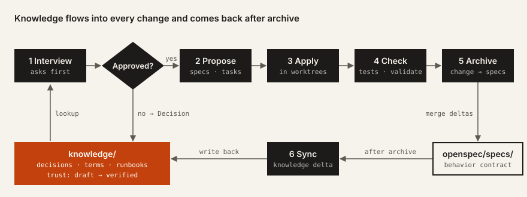
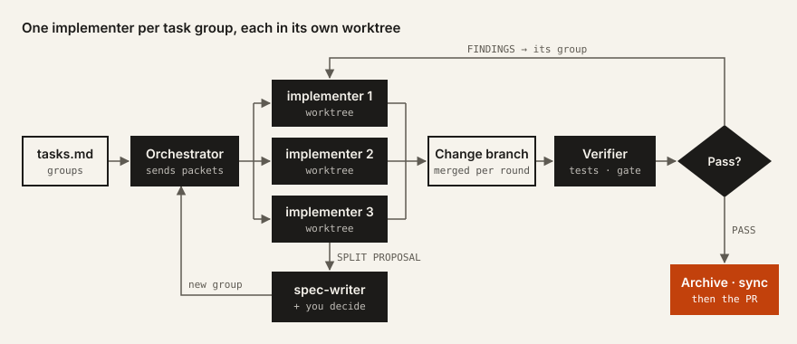
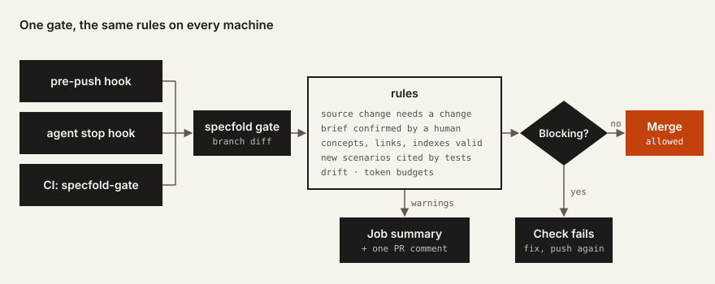

<h1>
  <picture>
    <source media="(prefers-color-scheme: dark)" srcset="brand/logo/lockup-inverse.svg">
    
  </picture>
</h1>

**Specs and knowledge, folded into one.** One agent workflow for any repository.

Specfold gives coding agents two sources of truth and one way to change them. An [OKF](https://github.com/GoogleCloudPlatform/open-knowledge-format) knowledge bundle holds the *why and what*, [OpenSpec](https://github.com/Fission-AI/OpenSpec) holds the *how*, and every behavior change edits both in one planned change. A CLI and a required CI gate check the result, the same way for every agent and every human.

[How it works](#how-it-works) · [Install](#install) · [Quick start](#quick-start) · [Agents](#works-with-your-agent) · [Parallel work](#parallel-work) · [The gate](#the-gate) · [Guides](#guides)

## Why

- **Agents guess when context is missing.** Every change starts with a planning interview: the agent looks up what the project already knows, then asks you every open decision before it writes anything.
- **Docs drift away from code.** Knowledge moves with the change that touches it, and the gate reports concepts whose code changed without them.
- **Rules only hold when something checks them.** Whatever must be correct is checked by deterministic code, in a git pre-push hook, in your agent's session hook where it has one, and in CI.
- **Context is expensive.** Agents load a small fixed set of instructions and look up the rest on demand; `specfold stats` keeps that set within budget.

## How it works

The repository has two halves:

- `knowledge/` holds decisions, terms, business rules, runbooks and the like, one concept per Markdown file. Agents write drafts; only humans mark a concept verified.
- `openspec/` holds the behavior contracts (`specs/`) and the changes that edit them (`changes/`). Tests cite the scenarios they cover.

A change carries both from idea to merge:

<picture>
  <source media="(prefers-color-scheme: dark)" srcset="brand/diagrams/workflow-dark.svg">
  
</picture>

1. **Interview.** The agent grounds itself in knowledge and specs and asks you every open decision, one at a time. A rejected proposal is recorded as a Decision with its reasons.
2. **Propose.** The approved brief becomes a proposal, spec deltas, a knowledge delta and task groups.
3. **Apply.** Each task group runs from a self-contained packet, one commit per task.
4. **Check.** `specfold change check` and `openspec validate --all --strict`, plus the tests.
5. **Archive.** The spec deltas merge into `openspec/specs/`.
6. **Sync.** The knowledge delta lands in `knowledge/`, and a retro asks what should have been asked earlier.

Before anything merges, [the gate](#the-gate) checks the result.

## Works with your agent

Specfold is plain files plus a CLI. Every step works with any coding agent that reads `AGENTS.md` and `.agents/skills/`, such as opencode or Codex, and the CLI and the gate check the same rules whatever wrote the code.

| What | Every agent | Where the agent supports more |
| --- | --- | --- |
| Instructions | `AGENTS.md`, kept short | imported by the tool's own file (`CLAUDE.md`) |
| Workflow | the `sf-*` skills | dedicated agents, such as a planner in plan mode |
| Questions | one decision at a time, recommended option first | a native question UI |
| Task groups | one after another | in parallel worktrees, one subagent per group |
| Checks | CLI, git hooks, CI gate | plus a session hook before the agent stops |

Claude Code supports all of the right-hand column today. The skills are written once in `.agents/skills/`; for tools that look elsewhere, such as Claude Code, `specfold agents sync` links them in.

## Install

You need Node.js 20 or later, git, and `gh` logged in with access to `samiuens/specfold` (the kit repository is private). OpenSpec 1.15 or later goes on the PATH or in `node_modules/.bin`.

Open your coding agent at the root of your repository and give it this prompt:

```text
Set up Specfold in this repository. Fetch the instructions with
gh api repos/samiuens/specfold/contents/BOOTSTRAP.md -H "Accept: application/vnd.github.raw"
and follow them. Ask me before every decision.
```

The agent downloads the newest release, checks its SHA-256 and picks the path for your repository:

| Your repository | What happens |
| --- | --- |
| **New or empty** | The agent asks a few questions, copies the kit in and runs `specfold init`. |
| **Existing code and docs** | The agent runs the `sf-migrate` skill: an inventory, a mapping plan you approve, the kit install and draft concepts from your docs, all in one PR on `specfold/migration`. |
| **By hand** | Download `specfold-template-<version>.tar.gz` and its `.sha256` from a release, check the hash, unpack it into the repository (`tar -xzf <file> --strip-components=1`), and run `node scripts/specfold.mjs init`. |

The prompt only fetches [`BOOTSTRAP.md`](BOOTSTRAP.md); you can also read it first and paste it into your agent yourself.

Details, including what init asks and what lands in the repository: [Getting started](docs/getting-started.md).

## Quick start

After install, tell your agent what you want:

1. **Plan.** "Plan a change: `<what you want>`". The `sf-plan` skill looks things up, asks you about every open decision and writes the change only after you approve it. (In Claude Code, start the planner agent instead: `claude --agent planner --permission-mode plan`.)
2. **Apply.** "Apply `<change>`". The `sf-apply` skill works the task groups from their packets, one commit per task.
3. **Check.** `node scripts/specfold.mjs change check <change>` and `openspec validate --all --strict`.
4. **Archive and sync.** `openspec archive <change>`, then the `sf-sync` skill, and open the PR. The `specfold-gate` check decides whether it may merge.

The full loop: [Workflow](docs/workflow.md).

## Parallel work

A change's tasks come in groups, and each group owns its files: no two groups share one. That makes the groups safe to run side by side:

<picture>
  <source media="(prefers-color-scheme: dark)" srcset="brand/diagrams/parallel-apply-dark.svg">
  
</picture>

- Each group gets a self-contained packet (`specfold tasks packet`): its tasks, files, specs and the knowledge to read.
- A task that needs a file outside its group stops with a split proposal; you decide whether the change's scope moves.
- A final check runs the tests, OpenSpec validation, the change check and the local gate, and ties every finding to a task group.

Agents with subagents run the groups in parallel worktrees, up to your personal limit (`specfold parallel set <n>`). Others work the same groups one after another, from the same packets. Several changes at once: `specfold wt plan` shows which ones touch different files.

## The gate

`specfold gate` runs every check on what a branch changes and gives one verdict. The same rules run in up to three places, so a problem shows up before CI does:

<picture>
  <source media="(prefers-color-scheme: dark)" srcset="brand/diagrams/gate-dark.svg">
  
</picture>

Make `specfold-gate` a required check, and nothing merges that fails it. Blocking findings fail the check; warnings go into the job summary and one PR comment. `gate` settings in `specfold.yaml` turn some rules up or down. The full rule list: [Workflow](docs/workflow.md#5-the-gate).

## Guides

- [Getting started](docs/getting-started.md): install, init, the first change.
- [Workflow](docs/workflow.md): plan, apply, check, archive and sync; parallel work; the gate.
- [Command reference](docs/commands.md): every CLI command, generated from its help.
- [Upgrading](docs/upgrading.md): channels, sources, private repositories, tokens, weekly upgrade PRs, conflicts.
- [Releasing](docs/releasing.md): how the kit itself is released (maintainers).

## This repository

Specfold is built with Specfold: the kit's own knowledge and specs live at the root, and what a repository receives lives in `template/`.

| Path | Content |
| --- | --- |
| `template/` | the payload a repository receives; packed into each release's tarball |
| `knowledge/`, `openspec/`, `specfold.yaml`, `AGENTS.md`, `CLAUDE.md` | the kit's own knowledge, specs and settings; none of it is shipped |
| `tools/specfold/` | CLI source, tests and release tooling |
| `scripts/specfold.mjs` | the bundled CLI (build output, committed) |
| `upgrade/` | upgrade notes and migrations, shipped in every tarball |
| `examples/sample-app/` | a worked example, upgraded from each release |
| `brand/` | logo, colour and type tokens, diagram style and sources, social preview |
| `docs/` | the guides; `docs/plan.md` is the historical build brief |
